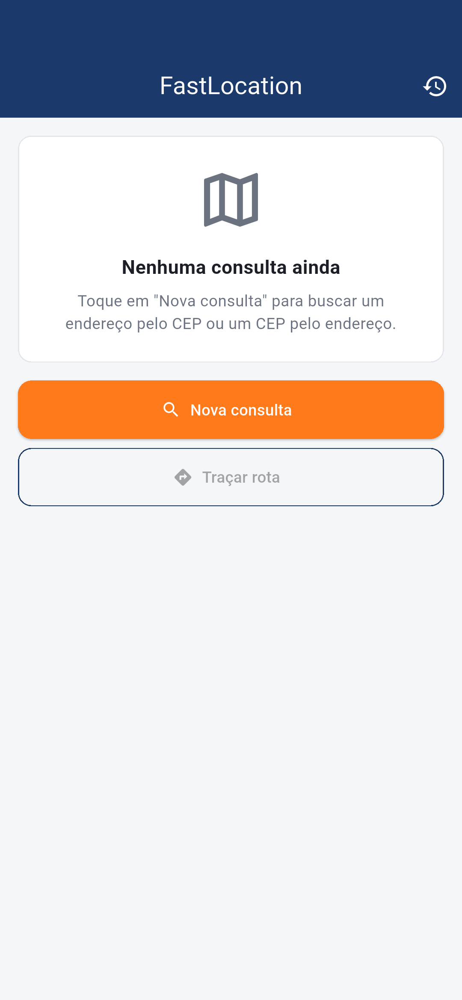
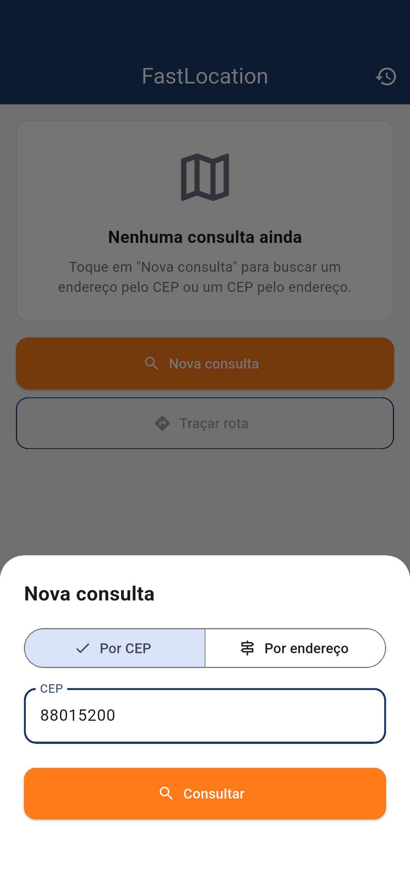
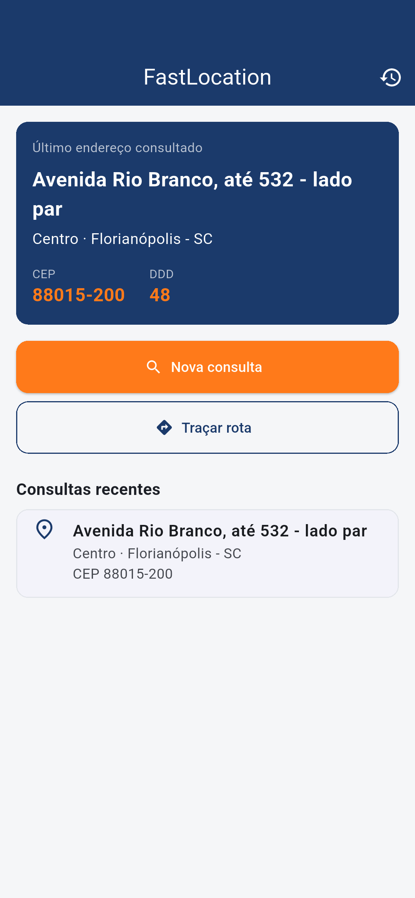
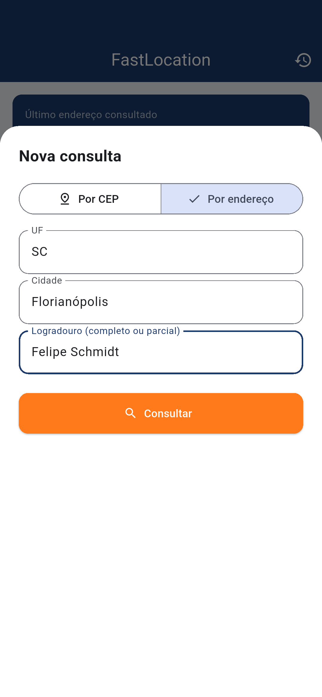
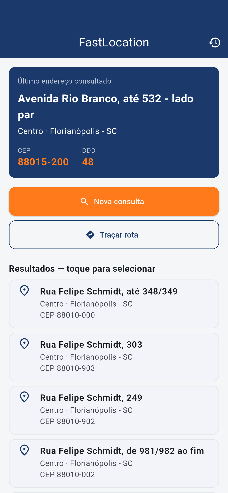
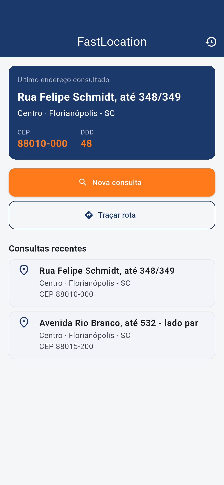
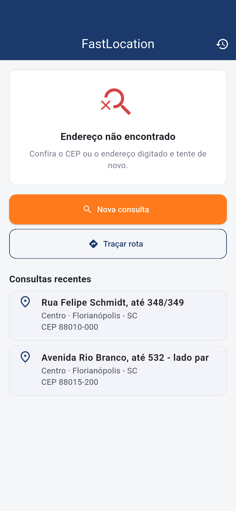
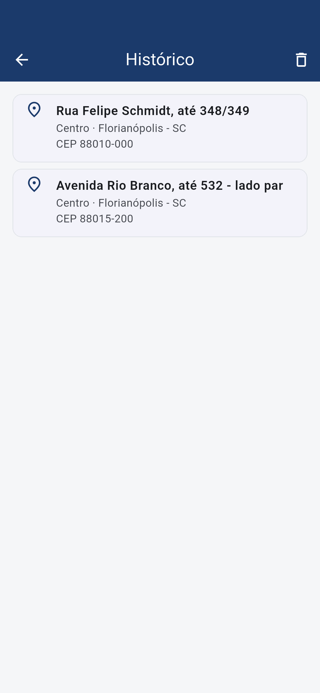

# FastLocation

Aplicativo Flutter da **FastDelivery** para os entregadores consultarem endereços pelo CEP e CEPs pelo endereço, sem precisar ligar para a matriz.

Desafio 2 — Desenvolvimento de Sistemas Móveis (ADS · UniSENAI) · Emanuel Yunes de Meirelles

## Funcionalidades

- Consulta de **endereço por CEP** na API pública [ViaCEP](https://viacep.com.br).
- Busca de **CEP por endereço completo ou parcial** (UF + cidade + logradouro).
- **Armazenamento local** com Hive: consultas recorrentes do mesmo CEP saem do aparelho, sem ir à internet.
- **Gerenciamento de estado** com MobX (`Observer` nas telas e `reaction` para os erros de consulta).
- **Tela de loading** durante a consulta externa.
- Componente de **resultado não encontrado**.
- Tela de **histórico** de endereços consultados, carregada automaticamente ao abrir.
- **Traçar rota** da localização atual do aparelho até o último endereço consultado (abre o Google Maps ou outro app de mapas instalado).
- Tela de abertura animada com redirecionamento automático para a Home.

## Telas

Prints tirados automaticamente pelo teste de ponta a ponta (`integration_test/app_test.dart`) num emulador Android, com consultas reais à API ViaCEP. O vídeo completo está na release [**demo**](https://github.com/EmanuelMeirelles-Oss/FastLocation/releases/tag/demo).

| Abertura | Home | Consulta por CEP | Resultado |
| --- | --- | --- | --- |
|  |  |  |  |

| Busca por endereço | Resultados | Endereço escolhido | Não encontrado | Histórico |
| --- | --- | --- | --- | --- |
|  |  |  |  |  |

## Tecnologias

| Pacote | Uso |
| --- | --- |
| dio | Requisições HTTP à API ViaCEP |
| mobx, flutter_mobx, mobx_codegen | Estado reativo das telas |
| hive, hive_flutter, hive_generator | Histórico local de consultas |
| path, path_provider | Pasta onde o Hive grava os dados |
| geocoding | Converte o endereço em coordenadas |
| map_launcher | Abre o app de mapas com a rota (^3.5.0 — ver nota abaixo) |
| build_runner | Geração de código (MobX e Hive) |

### Nota sobre a versão do map_launcher

O enunciado pede `map_launcher: ^2.2.1+1`. Toda a linha 2.x usa a *v1 embedding* do Android, que foi removida do Flutter atual, e por isso não compila mais (erro em `:map_launcher:compileReleaseKotlin`). A remoção só aconteceu na própria biblioteca na versão 3.4.0, então o projeto usa `^3.5.0`, que mantém exatamente a mesma API usada no app (`MapLauncher.installedMaps`, `showDirections`, `Coords`, `MapType`). As demais bibliotecas seguem as versões do enunciado.

## Como executar

Pré-requisitos: Flutter 3.x estável instalado (`flutter doctor` sem erros) e um emulador Android ou celular conectado.

```bash
git clone https://github.com/EmanuelMeirelles-Oss/FastLocation.git
cd FastLocation
flutter pub get
flutter run
```

As pastas `android/` e `ios/` e os arquivos gerados (`*.g.dart`) já estão no repositório. Se alterar um controller ou o model, gere o código de novo:

```bash
dart run build_runner build --delete-conflicting-outputs
```

### APK pronto

Cada push na `main` é compilado e testado pelo GitHub Actions (`.github/workflows/build.yml`). O APK da última versão fica na página **Releases** do repositório, para instalar direto no celular Android.

### Se as pastas nativas forem recriadas

Rodando `flutter create` de novo (ou os scripts `setup.ps1` / `setup.sh`), aplique também o ajuste do Gradle para plugins antigos e a permissão de mapas do iOS:

```bash
python tool/patch_android.py
```

No iOS, `ios/Runner/Info.plist` precisa de `LSApplicationQueriesSchemes` com `comgooglemaps` e `waze` para abrir esses apps (o Apple Maps funciona sem isso).

## Como usar

1. Na Home, toque em **Nova consulta**.
2. Escolha **Por CEP** (ex.: `88015200`) ou **Por endereço** (ex.: SC · Florianópolis · Felipe Schmidt).
3. Na busca por endereço, toque no resultado certo para selecioná-lo.
4. O endereço aparece em destaque como último consultado. Toque em **Traçar rota** para abrir o mapa.
5. O ícone de relógio no topo abre o **histórico** completo.

## Estrutura do projeto

```text
lib/
├── main.dart                        # main() refatorado: inicia o Hive e o app
└── src/
    ├── app_widget.dart              # MaterialApp, tema e rotas
    ├── http/http_client.dart        # configuração do Dio (ViaCEP)
    ├── routes/app_routes.dart       # nomes das rotas
    ├── shared/
    │   ├── colors/app_colors.dart
    │   ├── components/              # AppButton, AppLoading, AddressTile
    │   ├── metrics/app_metrics.dart # espaçamentos e tamanhos
    │   └── storage/                 # HiveConfig e nomes das caixas
    └── modules/
        ├── initial/page/            # tela de abertura animada
        ├── home/
        │   ├── components/          # AddressList, LastAddressCard, EmptySearch, SearchForm
        │   ├── controller/          # HomeController (MobX)
        │   ├── model/               # AddressModel (ViaCEP + Hive)
        │   ├── page/                # HomePage (Observer + reaction)
        │   ├── repositories/        # AddressRepository (API) e AddressLocalRepository (Hive)
        │   └── service/             # AddressService (regras de negócio)
        └── history/
            ├── controller/          # HistoryController (MobX)
            └── page/                # HistoryPage
```

Fluxo de uma consulta: `HomePage` → `HomeController` → `AddressService` → `AddressLocalRepository` (se o CEP já foi consultado) ou `AddressRepository` (ViaCEP) → resultado salvo no Hive → tela atualizada pelo `Observer`.

## Endpoints da API ViaCEP usados

| Consulta | Endpoint |
| --- | --- |
| Endereço por CEP | `GET https://viacep.com.br/ws/{cep}/json/` |
| CEP por endereço | `GET https://viacep.com.br/ws/{UF}/{cidade}/{logradouro}/json/` |

A busca por endereço exige pelo menos 3 letras na cidade e no logradouro (regra da própria API).

## Testes

Testes unitários e de widget:

```bash
flutter test
```

Teste de ponta a ponta (com um emulador ou celular Android conectado). Ele usa o app inteiro e salva os prints em `docs/screenshots`:

```bash
flutter drive --driver=test_driver/integration_test.dart --target=integration_test/app_test.dart
```

No GitHub Actions, o job **Teste no emulador** roda esse mesmo teste num emulador Android a cada push, grava a tela e publica o vídeo e os prints.

## Solução de problemas

- **Erro de versão ao rodar `flutter pub get`:** as versões das bibliotecas seguem as exigidas no enunciado. Se o seu Flutter for muito mais novo e alguma delas não resolver, rode `flutter pub outdated` para ver qual pacote conflita.
- **"Namespace not specified" no build Android:** algum plugin antigo não declara `namespace` para o Android Gradle Plugin 8. Rode `python tool/patch_android.py` e tente de novo.
- **"Nenhum aplicativo de mapas instalado" no emulador:** use um emulador com Google Play (ele já tem o Google Maps) ou um celular físico.
